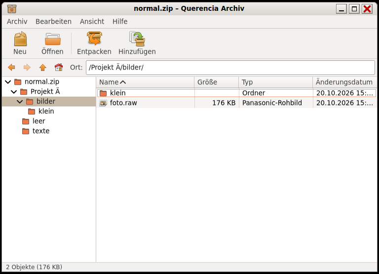

# Archivverwaltung (Querencia Archiv)

[Zurück zum Inhalt](index.md)

**Starten:** Anwendungen → Zubehör → Archivverwaltung, oder Doppelklick auf
ein Archiv (Querencia Archiv ist der Standard für 14 Archivtypen).



Eine Archivverwaltung nach dem Vorbild von File Roller 2.30 und Engrampa:
Menüleiste, Werkzeugleiste, Ortsleiste, Ordnerbaum, Dateiliste, Statusleiste.

## Was die Archivverwaltung kann

- **Öffnen und ansehen:** zip (auch mit Kennwort), tar, tar.gz, tar.xz,
  tar.bz2, tar.zst, einzelne .gz/.xz/.bz2/.zst-Dateien, 7z, RAR 4 und 5 (nur
  lesen), ISO, cpio und weitere. Doppelklick auf eine Datei im Archiv öffnet
  eine schreibgeschützte Kopie mit dem Standardprogramm.
- **Entpacken:** alles oder die Auswahl, mit Fortschritt und Abbrechen. Gibt
  es eine Datei schon: Ersetzen, Überspringen, für alle.
- **Sicher:** Archive mit Pfaden wie `..` oder absoluten Pfaden werden nicht
  entpackt; Verknüpfungen aus dem Archiv werden nie angelegt.
- **Erstellen:** neue Archive als zip, tar.gz oder tar.xz; Dateien und Ordner
  hinzufügen (auch durch Ziehen ins Fenster) und löschen. Dabei wird das
  Archiv neu geschrieben; das alte bleibt bis zum Schluss unverändert.

## Tasten

| Taste | Wirkung |
|---|---|
| Strg+N, Strg+O, Strg+E | Neues Archiv, Öffnen, Entpacken |
| Strg+W, Strg+Q | Fenster schließen, Programm beenden |
| Entf, Strg+A, Umschalt+Strg+A | Löschen, alles auswählen, Auswahl aufheben |
| Eingabe oder Doppelklick | Ordner öffnen bzw. Datei ansehen |
| Rücktaste, Alt+↑, Alt+←, Alt+→, Alt+Pos1 | eine Ebene hoch, zurück, vor, Anfang |
| F9, Strg+R oder F5 | Ordnerleiste, neu laden |

## Kommandozeile

```text
querencia-archiv [DATEI…]                        Archive öffnen
querencia-archiv --entpacken-hier DATEI…         neben dem Archiv entpacken
querencia-archiv --entpacken-nach ORDNER DATEI…  in ORDNER entpacken
querencia-archiv --erstellen ARCHIV DATEI…       neues .zip, .tar.gz oder .tar.xz
```

„Hier entpacken“ legt einen Ordner mit dem Namen des Archivs an, außer alles
liegt schon in einem einzigen Ordner.

## Nicht enthalten (0.1.0)

7z und RAR erstellen, Kennwörter beim Erstellen, verschlüsselte Archive
ändern, Dateien aus dem Fenster herausziehen, Umbenennen im Archiv,
Integritätsprüfung. Ein Eintrag „Hier entpacken“ im Kontextmenü von Files
folgt.
