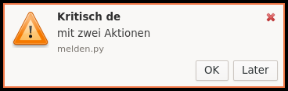

# Benachrichtigungen (Querencia Benachrichtigungen)

[Zurück zum Inhalt](index.md)

Der Dienst startet mit der Sitzung und zeigt Meldungen von Programmen an
(Standard `org.freedesktop.Notifications`, z. B. `notify-send`).



## So sehen Meldungen aus

- Sie erscheinen **oben rechts** unter dem oberen Panel und stapeln sich nach
  unten; höchstens fünf sind gleichzeitig zu sehen, weitere warten.
- **Anzeigedauer** nach Dringlichkeit: niedrig 3 s, normal 5 s; **kritische**
  Meldungen haben einen orangen Rand und bleiben, bis man sie schließt.
- Liegt der Mauszeiger auf einer Meldung, läuft ihre Zeit nicht ab.
- Ein Klick löst die Hauptaktion des Programms aus; Aktionsknöpfe erscheinen,
  wenn das Programm welche anbietet. Der Knopf „Schließen“ entfernt die
  Meldung.
- Bilder in Meldungen werden auf höchstens 48 Pixel verkleinert.

## Mitteilungszentrale

Jede Meldung (außer kurzlebigen, die das Programm als solche kennzeichnet)
kommt in einen Verlauf, der auch eine Neuanmeldung übersteht. Das Fenster
**Mitteilungszentrale** zeigt ihn nach Programm gruppiert, neueste oben, mit
Suchfeld, „Als gelesen“, „Entfernen“, „Alle entfernen“ und dem Schalter
„Nicht stören“. Tasten: Esc schließt, Entf entfernt, Eingabe löst die
Hauptaktion aus, Strg+F sucht.

Öffnen lässt sie sich über die **Glocke** im oberen Panel, über Anwendungen
→ Zubehör → Mitteilungszentrale oder über den Hinweis „in der Zentrale“ unten
rechts in einer Meldung.

- **Glocke:** zeigt die Zahl ungelesener Meldungen; Linksklick öffnet oder
  schließt die Zentrale, Rechtsklick bietet „Nicht stören“ und „Alle als
  gelesen markieren“.
- **Nicht stören** unterdrückt Meldungen außer kritischen; der Verlauf füllt
  sich weiter.
- In der dunklen Darstellung sind Meldungen und Zentrale dunkel.

## Im Terminal

Dasselbe geht auch im Terminal:

```bash
querencia-benachrichtigungen --nicht-stoeren an
```

```bash
querencia-benachrichtigungen --nicht-stoeren aus
```

```bash
querencia-benachrichtigungen --verlauf
```

```bash
querencia-benachrichtigungen --zentrale
```
