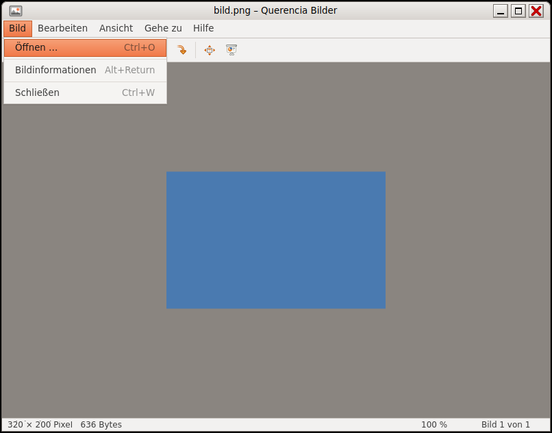

# Bildbetrachter (Querencia Bilder)

[Zurück zum Inhalt](index.md)

**Starten:** Doppelklick auf ein Bild (Bilder ist der Standard für PNG) oder
Anwendungen → Zubehör → Bildbetrachter. Ab Bilder 0.2.2 steht der Eintrag
unter Anwendungen → Grafik.

Ein Bildbetrachter nach dem Vorbild von Eye of GNOME 2.30. Er **schreibt nie**
in Bilddateien: Drehen wirkt nur auf die Anzeige, es gibt keine
Speicherfunktion.

## Was der Bildbetrachter kann

- Formate PNG, JPEG, GIF (erstes Bild), BMP, WebP und alles, was das System
  sonst lesen kann (z. B. AVIF, TIFF).
- Menüleiste Bild · Bearbeiten · Ansicht · Gehe zu · Hilfe, kompakte
  Werkzeugleiste, Statuszeile mit Größe und Zoomstufe.
- Blättern durch alle Bilder des Ordners, Zoomen, Einpassen, Drehen,
  Vollbild, Diaschau.
- Bildinformationen (Alt+Eingabe); die Ausrichtung aus den EXIF-Daten wird
  beim Anzeigen berücksichtigt.

## Tasten

| Taste | Wirkung |
|---|---|
| ←/→, Bild↑/Bild↓, Leertaste/Rücktaste | voriges / nächstes Bild |
| Pos1 / Ende | erstes / letztes Bild |
| + / −, Strg+Plus, Strg+=, Strg+Minus | vergrößern / verkleinern |
| 1 oder Strg+0 | Originalgröße (100 %) |
| F | an das Fenster anpassen |
| Strg+R / Umschalt+Strg+R | nach rechts / links drehen |
| F11, F5, Esc | Vollbild, Diaschau, beenden |
| Alt+Eingabe | Bildinformationen (Esc schließt) |
| Strg+O, Strg+W, Strg+Q | öffnen, schließen, beenden |

## Nicht enthalten

Animierte GIF (nur das erste Bild), Kameradaten aus EXIF (Belichtung usw.),
Miniaturleiste, Drucken, „In den Papierkorb“.
