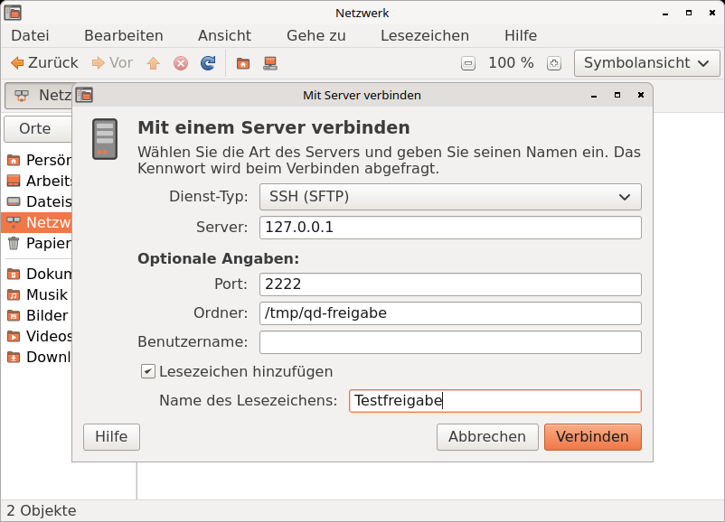

# Querencia Dateien – Dateimanager

[Zurück zum Inhalt](index.md)

**Starten:** Menü Orte (z. B. „Persönlicher Ordner“), Doppelklick auf ein
Ordner- oder Laufwerkssymbol der Arbeitsfläche oder Anwendungen → Zubehör →
Querencia Dateien. Querencia Dateien ist das Programm für Ordner: Wo ein
anderes Programm einen Ordner öffnet, öffnet er sich hier.

Querencia Dateien ist der Dateimanager von Querencia, gebaut nach dem
Vorbild von Nautilus 2.30: Menüleiste, Werkzeugleiste, Knopfpfad,
Seitenleiste „Orte“, Ansicht und Statusleiste. In der englischen Oberfläche
heißt er „Files“. Er ersetzt das frühere Querencia Files.

## Das Fenster

- **Menüleiste:** Datei, Bearbeiten, Ansicht, Gehe zu, Lesezeichen, Hilfe;
  ab zwei Reitern zusätzlich „Reiter“.
- **Werkzeugleiste:** Zurück, Vor, Nach oben, Stopp, Aktualisieren,
  Persönlicher Ordner, Rechner, Suchen; rechts die Zoomstufe mit − und + und
  die Wahl der Ansicht.
- **Adressleiste:** ein Knopf je Ordner des Pfads. Strg+L, „/“ oder „~“
  öffnet stattdessen ein Textfeld für den Ort, mit Ergänzung per Tab.
- **Statusleiste:** Zahl der Objekte und freier Speicherplatz, bei einer
  Auswahl deren Name und Größe.

Werkzeug-, Adress-, Seiten- und Statusleiste lassen sich im Menü „Ansicht“
aus- und einblenden. Die Rücktaste geht in den übergeordneten Ordner.

## Ansichten

| Ansicht | Kürzel | Was sie zeigt |
|---|---|---|
| Symbole | Strg+1 | große Symbole mit Namen, auf Wunsch mit weiteren Angaben darunter |
| Liste | Strg+2 | Spalten Name, Größe, Typ und Änderungsdatum; Zugriffsrechte, Eigentümer und Gruppe zuschaltbar; ein Klick auf den Spaltenkopf sortiert |
| Kompakt | Strg+3 | kleine Symbole mit Namen in Spalten nebeneinander; das Mausrad blättert waagrecht. Die Spalten sind in jeder Zoomstufe so breit wie der längste Name (bis 42 Zeichen); längere Namen stehen ganz im Tooltip |

- **Zoom:** Strg++ und Strg+- oder Strg+Mausrad, Strg+0 „Normale Größe“.
- **Anordnen:** Ansicht → Objekte anordnen: nach Name, Größe, Typ oder
  Änderungsdatum, „Umgekehrte Reihenfolge“; Ordner stehen vorn, solange
  das in den Einstellungen nicht abgeschaltet ist.
- **Verborgene Dateien** zeigt Strg+H.
- **Tippen** springt zum ersten Objekt, dessen Name so beginnt.

## Reiter

Ein Fenster kann mehrere Ordner in Reitern zeigen; jeder Reiter hat seine
eigene Ansicht und seinen eigenen Verlauf.

- **Strg+T** öffnet einen neuen Reiter mit dem gezeigten Ordner. Ab zwei
  Reitern erscheinen die Reiterleiste und das Menü „Reiter“.
- **Strg+W** schließt den Reiter; der letzte Reiter schließt das Fenster.
- **Strg+Bild↑ / Strg+Bild↓** wechselt zum vorherigen oder nächsten Reiter,
  **Umschalt+Strg+Bild↑ / Bild↓** verschiebt ihn, **Alt+1 … Alt+0** springt
  zu Reiter 1 bis 10.
- **Mittlere Maustaste** auf einen Ordner, einen Knopf der Adressleiste oder
  einen Ort der Seitenleiste öffnet ihn in einem neuen Reiter dahinter; mit
  gedrückter Umschalttaste in einem neuen Fenster.
- **„In neuem Reiter öffnen“** (Umschalt+Strg+O) steht im Menü Datei und in
  den Kontextmenüs. Mehrere ausgewählte Ordner öffnen sich je in einem Reiter.
- Dateien, die auf einen Reiterkopf gezogen werden, landen im Ordner dieses
  Reiters.

## Seitenleiste und Lesezeichen

Die Seitenleiste „Orte“ (ein und aus mit F9) zeigt Persönlicher Ordner,
Arbeitsfläche, Dateisystem, Netzwerk und Papierkorb, darunter die
Laufwerke und die Lesezeichen. Laufwerke lassen sich über ihr Kontextmenü
einhängen, aushängen und auswerfen; eingehängte Laufwerke und Server haben
dafür auch den Knopf ⏏.

**Strg+D** legt für den gezeigten Ordner ein Lesezeichen an; das Menü
„Lesezeichen“ listet alle. Querencia Dateien teilt die Lesezeichen mit dem
Dateiauswahldialog der GTK-Programme (`~/.config/gtk-3.0/bookmarks`).

## Netzwerk und „Mit Server verbinden“

**Gehe zu → Netzwerk** (oder „Netzwerk“ in der Seitenleiste) zeigt die
Rechner und Freigaben, die im lokalen Netz gefunden werden; jedes Gerät steht
nur einmal da. Ein Doppelklick öffnet es und verbindet bei Bedarf.

**Datei → Mit Server verbinden …** (auch im Kontextmenü von „Netzwerk“)
öffnet einen Server direkt:

- **Dienst-Typ:** SSH (SFTP), Windows-Freigabe (SMB), FTP (mit Anmeldung),
  WebDAV (HTTP), Sicheres WebDAV (HTTPS) oder „Eigene Adresse“ (z. B.
  `smb://server/freigabe` oder `\\server\freigabe`).
- **Server** und als optionale Angaben Port, Freigabe, Ordner, Benutzername
  und Domänenname.
- **Lesezeichen hinzufügen** mit eigenem Namen; das Lesezeichen entsteht erst
  nach einer gelungenen Verbindung und enthält kein Kennwort.

Das Kennwort wird beim Verbinden abgefragt, nie in der Adresse. Der Dialog
„Kennwort erforderlich“ fragt nach Benutzername, Domäne und Kennwort, wo es
der Server anbietet auch „Anonym verbinden“. „Kennwort merken“ ist aus; wer
es einschaltet, lässt das Kennwort im Schlüsselbund der Sitzung aufbewahren.

**Unbekannter SFTP-Server:** Vor dem Kennwort fragt der Dialog „Identität
des Servers prüfen“ und zeigt Typ und SHA256-Fingerabdruck des
Serverschlüssels. Vergleichen Sie ihn mit dem Fingerabdruck, den Sie vom
Verwalter des Servers kennen. „Verbindung abbrechen“ ist vorgewählt,
„Trotzdem verbinden“ muss man ausdrücklich wählen. Zeigt der Server danach
einen anderen Schlüssel, trennt Querencia Dateien die Verbindung und sagt
es.

Verbundene Server stehen in der Seitenleiste und lassen sich mit ⏏ trennen.
Klappt eine Verbindung nicht, nennt eine Meldung den Grund in einem Satz
(Server nicht gefunden, Verbindung abgelehnt, Anmeldung gescheitert …); ein
Server, der 60 Sekunden lang nicht antwortet, gilt als nicht erreichbar.

## Suchen

**Strg+F**, der Knopf „Suchen“ oder Gehe zu → Suchen … öffnet über der
Ansicht die Leiste „Suchen nach:“. Eingabe startet die Suche: Sie läuft ab
dem gezeigten Ordner durch alle Unterordner und findet Namen, die jedes
eingegebene Wort enthalten, ohne Rücksicht auf Groß- und Kleinschreibung.

- Die Treffer erscheinen als „Suchergebnisse“ mit den Spalten Name, Ort,
  Größe, Typ und Änderungsdatum. Doppelklick öffnet, das Kontextmenü bietet
  „Öffnen“ und „Im Ordner anzeigen“.
- Esc hält eine laufende Suche an, ein zweites Esc schließt die Leiste und
  zeigt wieder den Ordner.
- Die Statusleiste zeigt während der Suche die Zahl der Treffer, bei einer
  Auswahl in den Treffern deren Name und Größe; nach dem Schließen wieder
  den Ordner.
- Verborgene Dateien werden nur gefunden, wenn sie angezeigt werden (Strg+H).
- **Erweiterte Suche …** öffnet [Nach Dateien suchen](dateisuche.md) mit
  Ordner und Suchwort, etwa für die Suche im Dateiinhalt.

## Miniaturen

Bilder und andere Dateien zeigen in allen drei Ansichten eine Miniatur
statt des Symbols. Die Miniaturen liegen im gemeinsamen Zwischenspeicher
unter `~/.cache/thumbnails`, den auch andere Programme nutzen.

Unter Bearbeiten → Einstellungen → Vorschau steht „Vorschaubilder
anzeigen:“ auf **Immer**, **Nur lokale Dateien** (Vorgabe) oder **Nie**,
dazu „Nur für Dateien bis:“ (Vorgabe 10 MB). Änderungen wirken sofort.
Miniaturen für PDF und andere Nicht-Bild-Dateien erscheinen nur, wenn ein
passendes Vorschauprogramm und `bubblewrap` installiert sind; solche
Programme laufen immer abgeschottet.

## Dateien bearbeiten

- **Anlegen:** „Ordner anlegen“ (Umschalt+Strg+N) und „Dokument anlegen“
  (eine leere Datei oder eine Vorlage aus dem Ordner Vorlagen).
- **Kopieren und verschieben:** Ausschneiden, Kopieren, Einfügen (Strg+X,
  Strg+C, Strg+V), „In Ordner einfügen“ und Ziehen mit der Maus, auch zur
  Arbeitsfläche und in Dateidialoge. Beim Ziehen verschiebt Querencia
  Dateien auf demselben Laufwerk und kopiert auf ein anderes; mit Strg wird
  kopiert, mit Umschalt verschoben.
- **Umbenennen:** F2 benennt im Platz um; markiert ist der Name ohne
  Endung, bei Ordnern der ganze Name. Umschalt+F2 markiert immer den ganzen
  Namen.
- **Fortschritt:** Längere Vorgänge zeigt das Fenster „Dateioperationen“
  mit Fortschritt und „Abbrechen“. Gibt es am Ziel schon eine Datei oder
  einen Ordner dieses Namens, fragt es nach: Ersetzen, Zusammenführen
  (Ordner), Umbenennen, Überspringen, auf Wunsch für alle Dateien.
- **Auswählen:** Strg+A alles, Umschalt+Strg+I Auswahl umkehren.

## Papierkorb und Löschen

- **Entf** verschiebt die Auswahl in den Papierkorb. Im Papierkorb (Gehe zu
  → Papierkorb oder Seitenleiste) gibt es „Wiederherstellen“ und die Leiste
  „Papierkorb leeren …“; vor dem Leeren kommt eine Rückfrage.
- **Umschalt+Entf** löscht endgültig, ohne Papierkorb, nach einer Rückfrage.
  Als Menüeintrag „Löschen …“ erscheint das nur, wenn es in den
  Einstellungen (Verhalten) eingeschaltet ist.
- Hat ein Ort keinen Papierkorb (etwa manche Netzlaufwerke), fragt
  Querencia Dateien, ob sofort gelöscht werden soll.

## Öffnen und Eigenschaften

- **Doppelklick** öffnet mit dem Standardprogramm, z. B. Textdateien im
  Texteditor, PNG im Bildbetrachter, PDF im Dokumentenbetrachter, Archive in
  der Archivverwaltung. Andere Programme stehen unter „Öffnen mit“.
- Bei ausführbaren Textdateien fragt Querencia Dateien, ob sie ausgeführt
  oder angezeigt werden sollen; Programmstarter aus unbekannter Quelle
  starten erst nach „Vertrauen und starten“.
- **Eigenschaften** (Alt+Eingabe oder Strg+I) mit den Reitern Grundlegend,
  Zugriffsrechte und Öffnen mit. Unter Zugriffsrechte lässt sich auch
  „Datei als Programm ausführen“ setzen.

## Einstellungen

Bearbeiten → Einstellungen (ohne Tastenkürzel) öffnet „Einstellungen zur
Dateiverwaltung“ mit fünf Reitern. Jede Änderung wirkt sofort in allen
Fenstern, ohne „Übernehmen“.

| Reiter | Was sich einstellen lässt |
|---|---|
| Ansichten | Ansicht für neue Ordner, Anordnung, Ordner vor Dateien, verborgene Dateien, Standard-Zoomstufen |
| Verhalten | Einfacher oder Doppelklick zum Öffnen, ausführbare Textdateien, Nachfrage vor dem Leeren und Löschen, Befehl „Löschen“, Adressleiste immer als Textfeld |
| Anzeige | Angaben unter dem Namen in der Symbolansicht, Datumsformat, „Alle Spalten haben dieselbe Breite“ für die Kompaktansicht |
| Listenspalten | welche Spalten die Listenansicht zeigt |
| Vorschau | Vorschaubilder (siehe [Miniaturen](#miniaturen)) |

Die Einstellungen liegen in `~/.config/querencia/dateien.ini`. Einstellungen
aus Querencia Files übernimmt Dateien nach einem Upgrade von Alpha 2.1 nicht;
sie müssen hier neu gesetzt werden. Die Lesezeichen bleiben.

## Hilfe

Hilfe → Online-Hilfe (F1) öffnet die Dokumentation auf querencialinux.org
im Browser, „Fehler melden“ den Fehlertracker, „Info“ Version und Lizenz.

## Tastenkürzel

Alle Kürzel: [Tastenkürzel](tastenkuerzel.md#programme) oder Super+?.

## Gut zu wissen

- Rückgängig (Strg+Z) gibt es noch nicht.
- Eine Spaltenansicht wie in Querencia Files gibt es nicht.
- Die Suche findet nur Namen, keinen Dateiinhalt, und aktualisiert die
  Treffer nicht, wenn sich Dateien währenddessen ändern. In den
  Suchergebnissen wirken Entf, F2 und Strg+X/C/V nicht.
- Geöffnete Reiter werden beim nächsten Start nicht wiederhergestellt;
  Reiter lassen sich nicht mit der Maus verschieben.
- „Anzahl der Objekte in Ordnern zählen“ (Reiter Vorschau) wird gespeichert,
  wirkt aber noch nicht.
- Meldet das System beim Verbinden etwas, das Querencia Dateien nicht kennt,
  erscheint es als „Meldung des Systems“, je nach Systemsprache auch
  englisch.

Siehe auch [Bekannte Einschränkungen](bekannte-einschraenkungen.md).
