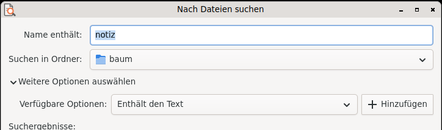

# Nach Dateien suchen (Querencia Dateisuche)

[Zurück zum Inhalt](index.md)

**Starten:** Anwendungen → Zubehör → Nach Dateien suchen …

Nach dem Vorbild von gnome-search-tool aus GNOME 2. Gesucht wird direkt im
Dateisystem, ohne Indexdienst.

## Suchen

- **Name enthält** (mit `*` und `?`, Groß- und Kleinschreibung egal) und
  **Suchen in Ordner**.
- **Weitere Optionen:** Enthält den Text, Datum geändert vor weniger bzw.
  mehr als N Tagen, Größe mindestens/höchstens, Datei ist leer, Besitzer,
  Gruppe, regulärer Ausdruck, versteckte und Sicherungsdateien,
  Verknüpfungen folgen, andere Dateisysteme, nur Ordner.
- Die Suche läuft im Hintergrund; „Stopp“ oder Esc hält sie sofort an.
  „Enthält den Text“ liest nur Textdateien bis 10 MB.

## Ergebnisse

Liste mit Symbol, Name, Ordner, Größe, Typ und Änderungsdatum, sortierbar.
Doppelklick oder Eingabe öffnet die Datei. Das Kontextmenü bietet Öffnen,
Öffnen mit …, Enthaltenden Ordner öffnen, Pfad kopieren (Strg+C), In den
Papierkorb verschieben (Entf, mit Rückfrage) und Ergebnisse als Textdatei
speichern.

Aufruf von der Kommandozeile:
`querencia-dateisuche [--ordner PFAD] [--name MUSTER] [--suchen]`.
