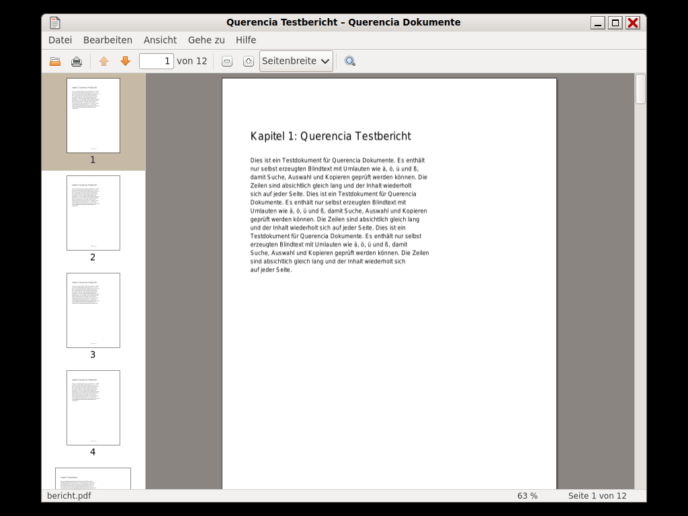

# Dokumentenbetrachter (Querencia Dokumente)

[Zurück zum Inhalt](index.md)

**Starten:** Anwendungen → Büro → Dokumentenbetrachter, oder Doppelklick auf
eine PDF-Datei (Querencia Dokumente ist der Standard für PDF).

Ein PDF-Betrachter nach dem Vorbild von Evince 2.30. Er **schreibt nie** in
Dokumente.

## Was der Dokumentenbetrachter kann

- PDF öffnen über den Dialog, aus Querencia Dateien oder durch Ziehen ins
  Fenster; auch passwortgeschützte PDF (mit Passwortabfrage).
- Fortlaufend blättern, Seitenleiste mit Miniaturen, Seitenfeld „Seite X von
  Y“ (auch Seitenbezeichnungen wie „iv“).
- Zoom in Stufen von 10 % bis 400 %, „Ganze Seite“, „Seitenbreite“,
  Strg+Mausrad.
- Textsuche mit Hervorhebung aller Treffer, weiter und zurück, wahlweise mit
  Groß- und Kleinschreibung.
- Text markieren und kopieren.
- Eigenschaften des Dokuments (Titel, Autor, Seiten, Papiergröße, Daten).
- Drucken über den GTK-Druckdialog, Vollbild, zuletzt geöffnete Dokumente.

## Tasten

| Taste | Wirkung |
|---|---|
| Strg+O, Strg+P, Alt+Eingabe | Öffnen, Drucken, Eigenschaften |
| Strg+W, Strg+Q | Fenster schließen, Programm beenden |
| Strg+F, Strg+G oder F3, Umschalt+Strg+G oder Umschalt+F3, Esc | Suchen, weiter, zurück, Suchleiste schließen |
| Strg+C, Strg+A | Kopieren, alles auswählen |
| Strg+Plus oder Strg+=, Strg+Minus, Strg+0, +/− | Zoom, 100 % |
| Bild↓/Bild↑, Pos1/Ende, Strg+Pos1/Strg+Ende | nächste/vorige, erste/letzte Seite |
| Strg+L | Seitenfeld |
| F9, F11 | Seitenleiste, Vollbild (Esc beendet) |

## Nicht enthalten

Bearbeiten, Speichern, Anmerkungen, Formulare, Signaturen und andere Formate
(PostScript, DjVu, XPS, Comics). Inhaltsverzeichnis und Verweise im Dokument
folgen in einer späteren Fassung. Drucken auf einen echten Drucker ist noch
nicht geprüft.
