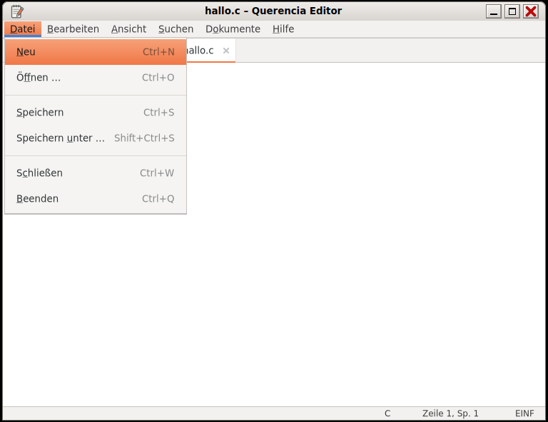

# Texteditor (Querencia Editor)

[Zurück zum Inhalt](index.md)

**Starten:** Anwendungen → Zubehör → Texteditor, oder Doppelklick auf eine
Textdatei (der Texteditor ist der Standard für Text und Markdown).

Ein klassischer Texteditor mit Reitern nach dem Vorbild von gedit 2.30.

## Was der Editor kann

- Mehrere Dokumente in Reitern eines Fensters; ein weiterer Aufruf öffnet
  einen neuen Reiter. „*“ im Reiter zeigt ungespeicherte Änderungen.
- Menüleiste Datei · Bearbeiten · Ansicht · Suchen · Dokumente · Hilfe mit
  Zugriffstasten und den gedit-2-Kürzeln.
- UTF-8; Zeichensatz und Zeilenende geladener Dateien bleiben erhalten.
- Zeilennummern, automatische Einrückung, Klammerhervorhebung, wahlweise
  Zeilenumbruch.
- Syntaxhervorhebung für `.md .conf .ini .json .xml .sh .py .rs .c` und
  weitere Formate; `.txt` als reiner Text.
- Suchen (Strg+F), Weitersuchen (Strg+G), rückwärts (Umschalt+Strg+G),
  Ersetzen (Strg+H) mit Groß-/Kleinschreibung, ganzen Wörtern und Umbruch;
  Gehe zu Zeile (Strg+I).
- Vor dem Schließen eines geänderten Dokuments fragt der Editor:
  Speichern, Abbrechen oder Ohne Speichern schließen.

Weitere Kürzel: [Tastenkürzel](tastenkuerzel.md#programme).

## Nicht enthalten

Drucken, Werkzeugleiste, Seitenleiste, Plugins, Rechtschreibprüfung,
Sitzungswiederherstellung, Einstellungsdialog.
