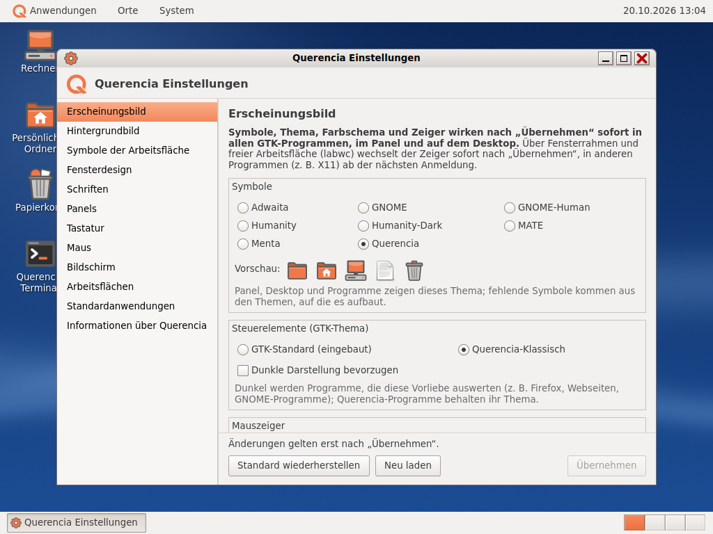

# Systemeinstellungen (Querencia Einstellungen)

[Zurück zum Inhalt](index.md)

**Starten:** System → Einstellungen → Systemeinstellungen, oder auf der
Arbeitsfläche Rechtsklick → „Hintergrund der Arbeitsfläche ändern …“.

Links steht die Liste der Bereiche, rechts der gewählte Bereich. Änderungen
gelten nach **Übernehmen**; „Standard wiederherstellen“ setzt den
Querencia-Standard zurück. Vor jeder Änderung an einer Konfigurationsdatei
legen die Einstellungen eine Sicherung an.

## Die Bereiche

**Erscheinungsbild**
- Symbolthema (z. B. Querencia, GNOME-Human, MATE) mit Vorschau,
  Steuerelemente-Thema (Querencia-Klassisch oder GTK-Standard),
  „Dunkle Darstellung bevorzugen“, Mauszeiger (Thema und Größe 24/32/48).
- Wirkt sofort in allen GTK-Programmen, im Panel und auf der Arbeitsfläche.
  Die dunkle Darstellung färben nur Programme um, die sie auswerten; die
  Querencia-Programme behalten ihr Thema.

**Hintergrundbild**
- Galerie der mitgelieferten Hintergründe mit Vorschau; ein Klick wählt,
  „Übernehmen“ setzt. Passend zum Bildschirm wird die Fassung 16:9 oder 4:3
  genommen.
- „Hintergrund …“ für ein eigenes Bild, eine einfarbige Fläche und die
  Darstellung (z. B. zentriert, gekachelt).

**Symbole der Arbeitsfläche**
- Rechner, Persönlicher Ordner und Papierkorb ein- oder ausblenden,
  Symbolgröße.
- Welche Datenträger erscheinen: Wechseldatenträger, optische Medien,
  Netzlaufwerke, eingebaute Laufwerke.

**Fensterdesign**
- Fensterthema, Eckenradius, Schatten, Anordnung der Titelleistenknöpfe,
  Schrift der Titelleiste.

**Schriften**
- Schrift für Anwendungen, Dokumente und dicktengleiche Schrift; Schrift der
  Fenstertitel (verweist auf „Fensterdesign“).

**Panels**
- Zeigt den gespeicherten Aufbau der Panels und erklärt die Bedienung im
  Panel selbst (Rechtsklick „Zum Panel hinzufügen …“, Verschieben, „Aus dem
  Panel entfernen“). Ändern kann man hier noch nichts.

**Tastatur**
- Tastaturbelegung aus allen Belegungen und Varianten (mit Suche),
  Wiederholverzögerung, Wiederholrate, Num-Taste.
- Mehrere Belegungen mit Umschalttaste gibt es noch nicht.

**Maus**
- Doppelklick-Zeit, Geschwindigkeit, Beschleunigung, Linkshänder,
  natürliches Rollen, Mauszeiger.

**Bildschirm**
- Je Bildschirm Auflösung, Wiederholrate, Drehung, Skalierung und Anordnung.
- Nach dem Anwenden fragt ein Dialog „Bildschirmeinstellungen behalten?“.
  Ohne Bestätigung innerhalb von 15 Sekunden kehrt der vorige Zustand zurück.
  Gespeicherte Einstellungen gelten auch bei der nächsten Anmeldung.

**Arbeitsflächen**
- Anzahl (1 bis 12), eigene Namen, Einblendung beim Wechsel und deren Dauer.

**Standardanwendungen**
- Welches Programm öffnet Webseiten, E-Mail, Text, Bilder, Musik, Video,
  Ordner, PDF und Archive. Das Terminal wird nur angezeigt.

**Sprache und Region**
- **Anzeigesprache:** Sprache der Menüs und Texte. Seit Alpha 3.3 gibt es
  Deutsch, Englisch, Italienisch, Spanisch und Französisch. Angeboten
  werden nur Sprachen, für die eine Locale installiert ist; das Paket
  `locales-all`, das Querencia Desktop seit Alpha 3.3 empfiehlt, bringt
  alle mit (rund 230 MB). Programme ohne Übersetzung zeigen Englisch.
- **Formate:** Datum und Uhrzeit, Zahlen, Währung, Papier und Maße, auch
  abweichend von der Anzeigesprache.
- Wirksam ab der nächsten Anmeldung; laufende Programme behalten ihre
  Sprache. Texte von GTK selbst (z. B. im Dateidialog) kommen aus dem
  Sprachpaket des Systems, `language-pack-gnome-<xx>`, zum Beispiel
  `sudo apt install language-pack-gnome-it`; ohne es bleiben sie englisch.

**Treiber** (seit Alpha 3.4)
- Auch direkt über System → Systemverwaltung → „Treiber“.
- **Grafik:** Grafikkarte, Kerneltreiber, OpenGL-Renderer und „Diese
  Sitzung:“, also ob OpenGL auf der Grafikkarte läuft oder als
  Software-OpenGL (llvmpipe).
- **Verfügbare Treiber:** die Treiber, die Ubuntu für die Karte kennt, mit
  „frei“ oder „proprietär“, „von Ubuntu empfohlen“ und dem Zustand („in
  Gebrauch“, „installiert, in Gebrauch nach einem Neustart“, „verfügbar“,
  „nicht installiert“). Querencia-Vorgabe ist der freie Treiber („Freier
  Treiber nouveau (Querencia-Vorgabe)“); den NVIDIA-Treiber nur wählen, wenn
  man ihn braucht. „Erneut suchen“ liest die Liste neu.
- **Wechseln:** Treiber wählen, „Änderungen anwenden“. Die Rückfrage
  „Treiber wechseln?“ nennt die Pakete, die installiert oder entfernt
  werden; dann fragt der Passwortdialog nach dem eigenen Passwort. Die
  Pakete kommen über PackageKit aus dem Netz; der Fortschritt steht oben auf
  der Seite, mit „Abbrechen“. „Zurücksetzen“ verwirft die Wahl. Zurück zum
  freien Treiber entfernt die Seite alle Pakete des NVIDIA-Treibers dieser
  Nummer.
- **Neu starten:** Ein neuer Treiber gilt erst nach einem Neustart. Die
  Seite zeigt „Den Rechner neu starten, damit der neue Treiber geladen
  wird.“ und den Knopf „Neu starten …“; er öffnet die Rückfrage der Sitzung.
- Die Liste liefert das Programm `ubuntu-drivers` aus dem Paket
  `ubuntu-drivers-common`, das die Einstellungen empfehlen. Fehlt es, bietet
  die Seite „ubuntu-drivers-common installieren …“ an.
- **Software-OpenGL:** Bei einer NVIDIA-Karte mit dem freien Treiber stellt
  die Sitzung OpenGL bei der Anmeldung auf Software um, weil Webseiten sonst
  abstürzen konnten; Vulkan bleibt auf der Karte. Mit dem NVIDIA-Treiber ist
  das nicht mehr nötig. Festlegen lässt es sich in
  `~/.config/querencia/grafik.ini` (`[Grafik]`, `Software-OpenGL = an` oder
  `aus`).
- In einer virtuellen Maschine vor einem Wechsel einen Snapshot anlegen.
  Kommt nach dem Neustart kein Bild, an der Textkonsole (Strg+Alt+F3)
  anmelden und die NVIDIA-Pakete mit `apt` wieder entfernen. Ein echter
  Wechsel ist noch nicht geprüft (siehe
  [Bekannte Einschränkungen](bekannte-einschraenkungen.md)).

**Informationen über Querencia**
- Versionen der Einstellungen, des Systems und von labwc.

## Wann wirkt was?

Die meisten Änderungen wirken sofort. Einstellungen, die der Fensterverwalter
liest (Tastatur, Maus, Fensterdesign, Titelschrift), lädt labwc beim
Übernehmen neu, Belegung und Tastenwiederholung gelten dann sofort. Nur die
Num-Taste wirkt erst ab der nächsten Anmeldung oder beim Anstecken einer
Tastatur.

## Noch nicht enthalten

Energie, Startprogramme und ein schreibender Bereich „Panels“ folgen in
späteren Fassungen.
