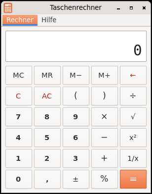

# Taschenrechner (Querencia Rechner)

[Zurück zum Inhalt](index.md)

**Starten:** Anwendungen → Zubehör → Taschenrechner.

Ein Taschenrechner wie gcalctool im einfachen Modus (GNOME 2.30).

## Was der Rechner kann

- Ziffern und Komma, `+ − × ÷` mit Punkt vor Strich und Klammern, Prozent,
  Quadratwurzel, Quadrat, Vorzeichenwechsel, Kehrwert.
- Speicher M+, M−, MR, MC (die Anzeige zeigt „M“, solange etwas gespeichert
  ist); Rücktaste, C, AC.
- Rechnet intern mit voller Genauigkeit und rundet nur für die Anzeige:
  `2 √ x²` ergibt 2, `0,1 + 0,2 − 0,3` ergibt 0.
- Kopieren und Einfügen mit Strg+C und Strg+V.
- Fehler (Division durch null, Überlauf, Wurzel aus negativer Zahl) stehen als
  Text in der Anzeige.
- Das Dezimalzeichen ist in beiden Sprachen das Komma.

## Tasten

Ziffern und Komma · `+ - * / %` · Eingabe oder `=` Ergebnis · Rücktaste
letzte Ziffer · Entf Eingabe löschen (C) · Esc alles löschen (AC) · S, Q, R, V
Wurzel, Quadrat, Kehrwert, Vorzeichen · Strg+Q beenden. Der Ziffernblock
funktioniert ebenfalls.

## Nicht enthalten

Wissenschaftlicher Modus, Programmierer-Modus, Einheiten, Verlauf.
