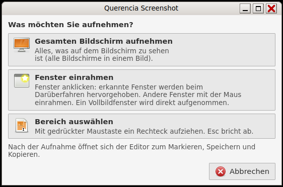

# Bildschirmfoto aufnehmen (Querencia Screenshot)

[Zurück zum Inhalt](index.md)

**Starten:** Taste **Druck**, **Alt+Druck** (ein Fenster) oder Anwendungen →
Zubehör → Bildschirmfoto aufnehmen.

## Aufnehmen

Druck öffnet das Auswahlfenster „Was möchten Sie aufnehmen?“:

- **Gesamten Bildschirm aufnehmen**
- **Fenster einrahmen** – erkannte Fenster leuchten beim Darüberfahren auf;
  ein Klick nimmt das Fenster samt Titelleiste und Rahmen auf. Zieht man
  außerhalb eines erkannten Fensters, rahmt man frei ein. Esc bricht ab.
- **Bereich auswählen** – einen Rahmen aufziehen.

Alt+Druck springt direkt in die Fensterwahl. Esc, Strg+W oder Strg+Q schließen
das Auswahlfenster.

## Markieren

Nach jeder Aufnahme öffnet sich der Editor mit Menüleiste (Datei, Bearbeiten,
Werkzeuge, Ansicht) und Werkzeugleiste.

| Werkzeug / Aktion | Taste |
|---|---|
| Kreis/Ellipse (Umschalt = Kreis) | E |
| Rechteck (Umschalt = Quadrat) | R |
| Pfeil | A |
| Stift | P |
| Text (klicken, tippen, Eingabe; Esc verwirft) | T |
| Farbpalette | F |
| Rückgängig / Wiederholen | Strg+Z / Strg+Umschalt+Z oder Strg+Y |
| Speichern … / In die Zwischenablage | Strg+S / Strg+C |
| Neue Aufnahme / Schließen | Strg+N / Strg+W oder Strg+Q |

Acht Grundfarben (Rot ist Standard) und „Benutzerdefinierte Farbe …“, drei
Strichstärken. „Alle Markierungen entfernen“ fragt nach und lässt sich
rückgängig machen. Die Aufnahme selbst bleibt unverändert; erst Speichern und
Kopieren erzeugen ein neues PNG in Originalgröße.

## Speichern

Der Dialog „Bildschirmfoto speichern“ zeigt eine Vorschau, Name und Ordner.
Vorgabe ist der Ordner `Screenshots` im Bilder-Ordner. Vorhandene Dateien
werden nie überschrieben. Wer mit ungespeicherten Markierungen schließt, wird
gefragt: „Ohne Speichern schließen“, „Abbrechen“ oder „Speichern …“.

Mit `querencia-screenshot --open DATEI` lässt sich ein vorhandenes PNG
bearbeiten; gespeichert wird unter neuem Namen.

## Grenzen

Die Fensterwahl erkennt nur Fenster mit labwc-Rahmen; bei einer Skalierung
ungleich 1 bleibt nur das freie Einrahmen. In einer virtuellen Maschine hatte
Alt+Druck bei der Installationsprobe keine Wirkung; an echter Hardware ist das
noch zu prüfen.
