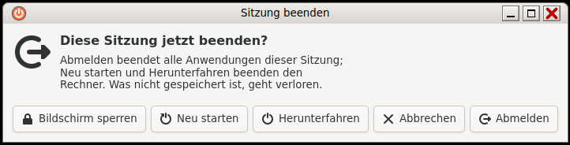

# Sitzung: Abmelden, Sperren, Ausschalten (Querencia Sitzung)

[Zurück zum Inhalt](index.md)



## Bildschirm sperren

- **Strg+Alt+L** sperrt sofort.
- Nach **10 Minuten** ohne Eingabe sperrt sich der Bildschirm selbst.
- Der Sperrbildschirm zeigt Uhr und Passwortfeld auf jedem Bildschirm;
  entsperrt wird mit dem eigenen Passwort.

## Sitzungsdialog

**Strg+Alt+Entf** öffnet einen Dialog mit **Abmelden**, **Bildschirm
sperren**, **Neu starten** und **Herunterfahren**. Esc oder „Abbrechen“
schließt ihn; Pfeiltasten und Eingabe funktionieren.

## Abmelden und Ausschalten über das Menü

- **System → Abmelden …** fragt „Möchten Sie sich wirklich abmelden?“.
- **System → Ausschalten …** fragt vor dem Herunterfahren.

Die Rückfragen warten, bis man wählt; sie zählen nicht von selbst herunter.
Wer einen Countdown möchte, trägt ihn in `~/.config/querencia/sitzung.ini`
ein:

```ini
[Dialog]
Countdown=an
```

Beim Abmelden beendet Querencia zuerst die Programme der Sitzung und dann
die Sitzungsdienste; danach kann man sich sofort wieder anmelden.

## Passwortdialog

Verlangt ein Programm Administratorrechte (z. B. Software beim Installieren,
Neu starten), erscheint der Passwortdialog der Sitzung („Legitimierung erforderlich“) und
fragt nach dem eigenen Passwort.

## Gut zu wissen

Den Sperrbildschirm gibt es seit Alpha 3.4 in allen fünf Sprachen; er
folgt der Systemsprache.
