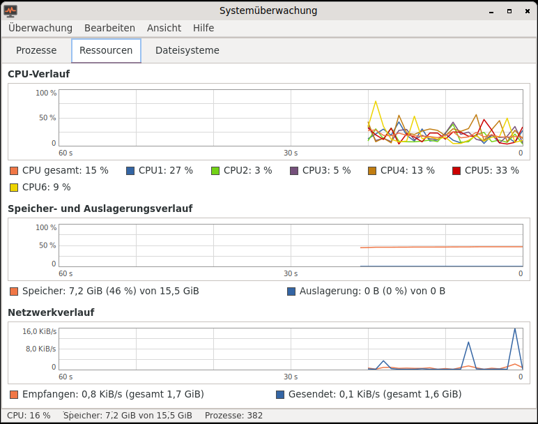

# Systemüberwachung (Querencia Systemmonitor)

[Zurück zum Inhalt](index.md)

**Starten:** Anwendungen → Systemwerkzeuge → Systemüberwachung.

Nach dem Vorbild der GNOME-2-Systemüberwachung, mit drei Reitern.

## Prozesse

- Spalten Prozessname, Benutzer, PID, % CPU, Speicher, Nice, Zustand;
  Sortieren per Klick auf den Spaltenkopf.
- Filter Alle / Eigene / Aktive, Suche nach Name, PID oder Benutzer (Strg+F).
- Aktualisierung alle 1 bis 10 Sekunden (Standard 2 s); Auswahl und
  Bildlaufposition bleiben dabei stehen.
- **Beenden** (Entf oder Strg+E) und **Abwürgen** (Strg+K) mit Rückfrage,
  **Priorität ändern** (Strg+N; ohne Administratorrechte nur senken),
  **Eigenschaften** (Alt+Eingabe oder Doppelklick): Befehlszeile,
  Arbeitsverzeichnis, Startzeit, geöffnete Dateien.
- Prozesse anderer Benutzer werden nur angezeigt.

## Ressourcen

Verlauf der letzten 60 Sekunden: CPU gesamt und je Kern, Speicher und
Auslagerung, Netzwerk empfangen und gesendet.

## Dateisysteme

Gerät, Einhängepunkt, Typ, Größe, frei, verfügbar, belegt mit Balken.
Virtuelle Dateisysteme (tmpfs, overlay, squashfs) sind ausgeblendet und lassen
sich zuschalten.

Fenstergröße, Reiter, Intervall, Filter, Sortierung und Spalten merkt sich das
Programm.
