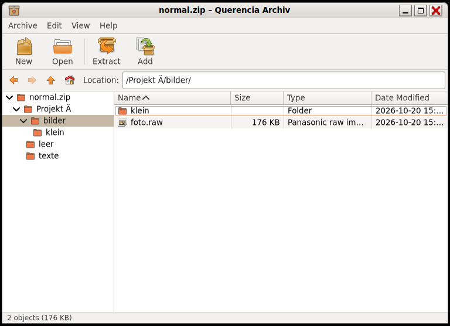

# Archive Manager (Querencia Archiv)

[Back to contents](index.md)

**Start:** Applications → Accessories → Archive Manager, or double-click an
archive (Querencia Archiv is the default for 14 archive types).



An archive manager modelled on File Roller 2.30 and Engrampa: menu bar,
toolbar, location bar, folder tree, file list, status bar.

## What the Archive Manager can do

- **Open and browse:** zip (also with password), tar, tar.gz, tar.xz,
  tar.bz2, tar.zst, single .gz/.xz/.bz2/.zst files, 7z, RAR 4 and 5 (read
  only), ISO, cpio and more. Double-clicking a file in the archive opens a
  read-only copy with the default program.
- **Extract:** everything or the selection, with progress and cancel. If a
  file already exists: replace, skip, for all.
- **Safe:** archives with paths like `..` or absolute paths are not
  extracted; links from the archive are never created.
- **Create:** new archives as zip, tar.gz or tar.xz; add files and folders
  (also by dropping them on the window) and delete them. The archive is
  rewritten; the old one stays untouched until the end.

## Keys

| Key | Effect |
|---|---|
| Ctrl+N, Ctrl+O, Ctrl+E | New archive, Open, Extract |
| Ctrl+W, Ctrl+Q | close window, quit |
| Del, Ctrl+A, Shift+Ctrl+A | delete, select all, select none |
| Return or double-click | open folder or view file |
| Backspace, Alt+↑, Alt+←, Alt+→, Alt+Home | up one level, back, forward, top |
| F9, Ctrl+R or F5 | folder pane, reload |

## Command line

```text
querencia-archiv [FILE…]                         open archives
querencia-archiv --entpacken-hier FILE…          extract next to the archive
querencia-archiv --entpacken-nach FOLDER FILE…   extract into FOLDER
querencia-archiv --erstellen ARCHIVE FILE…       new .zip, .tar.gz or .tar.xz
```

“Extract here” creates a folder named after the archive, unless everything is
already inside a single folder.

## Not included (0.1.0)

Creating 7z and RAR, passwords when creating, changing encrypted archives,
dragging files out of the window, renaming inside the archive, integrity
check. An “Extract here” entry in the context menu of
[Querencia Dateien](dateien.md) does not exist yet (open); there a
double-click opens the archive in the Archive Manager.
