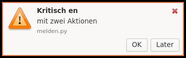

# Notifications (Querencia Benachrichtigungen)

[Back to contents](index.md)

The service starts with the session and shows messages from programs
(standard `org.freedesktop.Notifications`, e.g. `notify-send`).



## What notifications look like

- They appear at the **top right** below the top panel and stack downwards;
  at most five are visible at a time, more wait.
- **Display time** by urgency: low 3 s, normal 5 s; **critical** messages have
  an orange border and stay until closed.
- While the mouse pointer rests on a message, its time does not run out.
- A click triggers the program's main action; action buttons appear when the
  program offers some. The “Close” button removes the message.
- Pictures in messages are scaled down to at most 48 pixels.

## Notification centre

Every message (except short-lived ones the program marks as such) goes into
a history that also survives a new login. The **notification centre** window
(“Mitteilungszentrale”) shows it grouped by program, newest on top, with a
search field, “Mark as Read”, “Remove”, “Remove All” and the “Do Not
Disturb” switch. Keys: Esc closes, Del removes, Return triggers the main
action, Ctrl+F searches.

Open it with the **bell** in the top panel, through Applications →
Accessories → Notification Center, or with the hint “in the notification
center” at the bottom right of a message.

- **Bell:** shows the number of unread messages; a left click opens or closes
  the centre, a right click offers “Nicht stören” (do not disturb) and “Alle
  als gelesen markieren” (mark all as read).
- **Do not disturb** suppresses messages except critical ones; the history
  keeps filling.
- In the dark appearance messages and the centre are dark.

## In the terminal

The same works in the terminal:

```bash
querencia-benachrichtigungen --nicht-stoeren an
```

```bash
querencia-benachrichtigungen --nicht-stoeren aus
```

```bash
querencia-benachrichtigungen --verlauf
```

```bash
querencia-benachrichtigungen --zentrale
```

(`an` = on, `aus` = off, `--verlauf` = history, `--zentrale` = open the
notification centre.)
