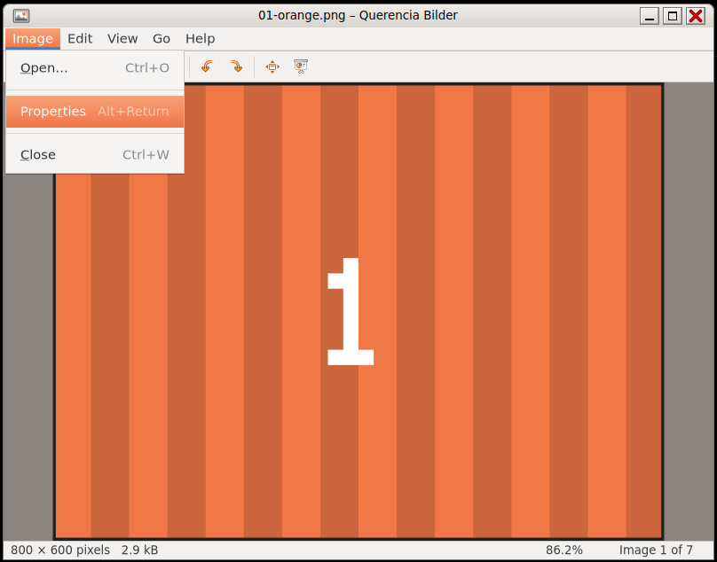

# Image Viewer (Querencia Bilder)

[Back to contents](index.md)

**Start:** double-click an image (Bilder is the default for PNG) or
Applications → Graphics → Image Viewer.

An image viewer modelled on Eye of GNOME 2.30. It **never writes** to image
files: rotating only affects the view, there is no save function.

## What the image viewer can do

- Formats PNG, JPEG, GIF (first frame), BMP, WebP and whatever else the
  system can read (e.g. AVIF, TIFF).
- Menu bar Image · Edit · View · Go · Help, compact toolbar, status bar with
  size and zoom level.
- Browse all images of the folder, zoom, best fit, rotate, fullscreen,
  slideshow.
- Image properties (Alt+Return); the EXIF orientation is applied when
  displaying.

## Keys

| Key | Effect |
|---|---|
| ←/→, PgUp/PgDn, Space/Backspace | previous / next image |
| Home / End | first / last image |
| + / −, Ctrl+Plus, Ctrl+=, Ctrl+Minus | zoom in / out |
| 1 or Ctrl+0 | original size (100 %) |
| F | best fit |
| Ctrl+R / Shift+Ctrl+R | rotate right / left |
| F11, F5, Esc | fullscreen, slideshow, leave |
| Alt+Return | image properties (Esc closes) |
| Ctrl+O, Ctrl+W, Ctrl+Q | open, close, quit |

## Not included

Animated GIF (first frame only), camera data from EXIF (exposure etc.),
thumbnail bar, printing, “Move to Trash”.
