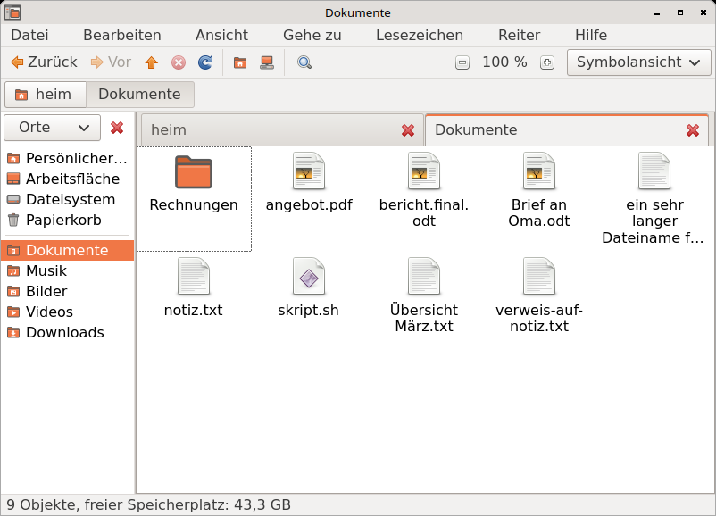
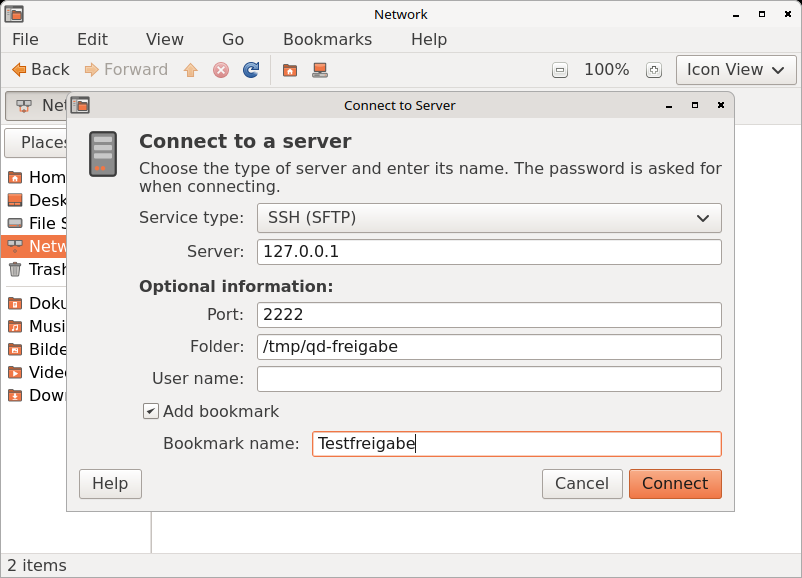

# Querencia Dateien – file manager

[Back to contents](index.md)

**Start:** menu Orte (Places), e.g. “Persönlicher Ordner” (Home); double-click
a folder or drive icon on the desktop; or Applications → Accessories →
Files. Querencia Dateien is the program for folders: wherever another
program opens a folder, it opens here.

Querencia Dateien is Querencia's file manager, modelled on Nautilus 2.30:
menu bar, toolbar, path bar, side pane “Places”, view and status bar. In the
English interface its menu entry and the About dialog say “Files”. It replaces
the earlier Querencia Files.

## The window

- **Menu bar:** File, Edit, View, Go, Bookmarks, Help; with two or more tabs
  also “Tabs”.
- **Toolbar:** Back, Forward, up to the parent folder, Stop, Reload, Home
  Folder, Computer, Search; on the right the zoom level with − and + and the
  choice of view.
- **Location bar:** one button per folder of the path. Ctrl+L, “/” or “~”
  opens a text field for the location instead, with completion by Tab.
- **Status bar:** number of items and free space; for a selection its name
  and size.

The toolbar, location bar, side pane and status bar can be hidden and shown
in the “View” menu. Backspace goes to the parent folder.

## Views

| View | Shortcut | What it shows |
|---|---|---|
| Icons | Ctrl+1 | large icons with names, optionally with more details below |
| List | Ctrl+2 | columns Name, Size, Type and Date Modified; Permissions, Owner and Group can be added; a click on a column header sorts |
| Compact | Ctrl+3 | small icons with names in columns side by side; the mouse wheel scrolls sideways |

- **Zoom:** Ctrl++ and Ctrl+- or Ctrl+mouse wheel, Ctrl+0 “Normal Size”.
- **Arrange:** View → Arrange Items: by name, size, type or modification
  date, “Reversed Order”; folders come first unless switched off in the
  preferences.
- **Hidden files** are shown with Ctrl+H.
- **Typing** jumps to the first item whose name starts that way.

## Tabs

A window can show several folders in tabs; each tab has its own view and its
own history.

- **Ctrl+T** opens a new tab with the folder shown. With two or more tabs the
  tab bar and the “Tabs” menu appear.
- **Ctrl+W** closes the tab; the last tab closes the window.
- **Ctrl+Page Up / Ctrl+Page Down** switches to the previous or next tab,
  **Shift+Ctrl+Page Up / Page Down** moves it, **Alt+1 … Alt+0** jumps to
  tab 1 to 10.
- **Middle mouse button** on a folder, a button of the location bar or a
  place in the side pane opens it in a new tab behind the current one; with
  Shift held down in a new window.
- **“Open in New Tab”** (Shift+Ctrl+O) is in the File menu and the context
  menus. Several selected folders open in one tab each.
- Files dragged onto a tab header land in that tab's folder.

## Side pane and bookmarks

The side pane “Places” (on and off with F9) shows Home Folder, Desktop, File
System, Network and Trash, below them the drives and the bookmarks. Drives
can be mounted, unmounted and ejected from their context menu; mounted
drives and servers also have the ⏏ button for it.

**Ctrl+D** adds a bookmark for the folder shown; the “Bookmarks” menu lists
them all. Querencia Dateien shares its bookmarks with the file chooser of
GTK programs (`~/.config/gtk-3.0/bookmarks`).

## Network and “Connect to Server”

**Go → Network** (or “Network” in the side pane) shows the computers and
shares found on the local network; each device is listed only once. A
double-click opens it and connects when needed.

**File → Connect to Server…** (also in the context menu of “Network”) opens a
server directly:

- **Service type:** SSH (SFTP), Windows share (SMB), FTP (with login), WebDAV
  (HTTP), Secure WebDAV (HTTPS) or “Custom location” (e.g.
  `smb://server/share` or `\\server\share`).
- **Server** and, as optional information, Port, Share, Folder, User name and
  Domain name.
- **Add bookmark** with its own name; the bookmark is only created after a
  successful connection and contains no password.

The password is asked for when connecting, never in the address. The dialog
“Password Required” asks for user name, domain and password, and offers
“Connect anonymously” where the server allows it. “Remember password” is off;
if you switch it on, the password is kept in the keyring of your session.

**Unknown SFTP server:** before the password, the dialog “Verify Server
Identity” shows the type and the SHA256 fingerprint of the server key.
Compare it with the fingerprint you know from the server's administrator.
“Cancel Connection” is preselected; “Connect Anyway” has to be chosen
explicitly. If the server shows a different key afterwards, Querencia Dateien
closes the connection and says so.

Connected servers appear in the side pane and are disconnected with ⏏. If a
connection fails, a message gives the reason in one sentence (server not
found, connection refused, login failed …); a server that does not answer
for 60 seconds counts as unreachable.

## Search

**Ctrl+F**, the “Search” button or Go → Search… opens the bar “Search for:”
above the view. Return starts the search: it runs from the folder shown
through all subfolders and finds names that contain every word typed,
ignoring upper and lower case.

- The hits appear as “Search results” with the columns Name, Location, Size,
  Type and Date Modified. A double-click opens, the context menu offers
  “Open” and “Show in Folder”.
- Esc stops a running search; a second Esc closes the bar and shows the
  folder again.
- Hidden files are only found while they are shown (Ctrl+H).
- **Advanced Search…** opens [Search for Files](dateisuche.md) with folder
  and search word, for example to search file contents.

## Thumbnails

Images and other files show a thumbnail instead of the icon in all three
views. The thumbnails are kept in the shared cache `~/.cache/thumbnails`,
which other programs use too.

Under Edit → Preferences → Preview, “Show thumbnails:” is **Always**,
**Local files only** (default) or **Never**, plus “Only for files smaller
than:” (default 10 MB). Changes apply at once. Thumbnails for PDF and other
non-image files only appear when a suitable thumbnailer and `bubblewrap` are
installed; such programs always run sandboxed.

## Working with files

- **Create:** “Create Folder” (Shift+Ctrl+N) and “Create Document” (an empty
  file or a template from the Templates folder).
- **Copy and move:** Cut, Copy, Paste (Ctrl+X, Ctrl+C, Ctrl+V), “Paste Into
  Folder” and dragging with the mouse, also to the desktop and into file
  dialogs. When dragging, Querencia Dateien moves on the same drive and
  copies to another one; with Ctrl it copies, with Shift it moves.
- **Rename:** F2 renames in place; the name without its extension is
  selected, for folders the whole name. Shift+F2 always selects the whole
  name.
- **Progress:** longer operations show the window “File Operations” with
  progress and “Cancel”. If a file or folder of the same name exists at the
  destination, it asks: Replace, Merge (folders), Rename, Skip, optionally
  for all files.
- **Select:** Ctrl+A all, Shift+Ctrl+I invert selection.

## Trash and deleting

- **Del** moves the selection to the trash. In the trash (Go → Trash or the
  side pane) there is “Restore” and the bar “Empty Trash…”; emptying asks
  first.
- **Shift+Del** deletes permanently, bypassing the trash, after a question.
  The menu entry “Delete…” only appears when switched on in the preferences
  (Behavior).
- If a place has no trash (some network drives, for example), Querencia
  Dateien asks whether to delete immediately.

## Opening and properties

- **Double-click** opens with the default program, e.g. text files in the
  Text Editor, PNG in the Image Viewer, PDF in the Document Viewer, archives
  in the Archive Manager. Other programs are listed under “Open With”.
- For executable text files Querencia Dateien asks whether to run or display
  them; launchers from an unknown source only start after “Trust and
  Launch”.
- **Properties** (Alt+Return or Ctrl+I) with the tabs Basic, Permissions and
  Open With. Under Permissions you can also set “Allow executing file as
  program”.

## Preferences

Edit → Preferences (no shortcut) opens “File Management Preferences” with
five tabs. Every change applies at once in all windows, without “Apply”.

| Tab | What can be set |
|---|---|
| Views | view for new folders, arrangement, folders before files, hidden files, default zoom levels |
| Behavior | single or double click to open, executable text files, asking before emptying and deleting, “Delete” command, location bar always as text field |
| Display | details below the name in the icon view, date format, “All columns have the same width” for the compact view |
| List Columns | which columns the list view shows |
| Preview | thumbnails (see [Thumbnails](#thumbnails)) |

On its first start Querencia Dateien takes over six settings from Querencia
Files once, if present: hidden files, view, sorting, folders first, single or
double click and the side pane. The settings are stored in
`~/.config/querencia/dateien.ini`.

## Help

Help → Online Help (F1) opens the documentation on querencialinux.org in the
browser, “Report a Bug” the bug tracker, “About” version and license.

## Shortcuts

All shortcuts: [Keyboard shortcuts](tastenkuerzel.md#programs) or Super+?.

## Good to know

- Undo (Ctrl+Z) does not exist yet.
- There is no column view as in Querencia Files; whoever used the columns
  there gets the list view on the first start.
- Search only finds names, not file contents, and does not update the hits
  when files change meanwhile. In the search results Del, F2 and
  Ctrl+X/C/V have no effect.
- Open tabs are not restored on the next start; tabs cannot be moved with
  the mouse.
- “Count number of items” (Preview tab) is saved but has no effect yet.
- If the system reports something on connecting that Querencia Dateien does
  not know, it appears as “Message from the system”, in English or German
  depending on the system language.

See also [Known limitations](bekannte-einschraenkungen.md).
