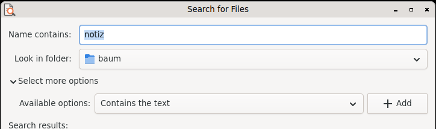

# Search for Files (Querencia Dateisuche)

[Back to contents](index.md)

**Start:** Applications → Accessories → Search for Files…

Modelled on gnome-search-tool from GNOME 2. It searches the file system
directly, without an index service.

## Searching

- **Name contains** (with `*` and `?`, case-insensitive) and **Look in
  folder**.
- **More options:** contains the text, date modified less or more than N days
  ago, size at least/at most, file is empty, owner, group, regular
  expression, hidden and backup files, follow links, other file systems,
  folders only.
- The search runs in the background; “Stop” or Esc stops it at once.
  “Contains the text” only reads text files up to 10 MB.

## Results

List with icon, name, folder, size, type and date modified, sortable.
Double-click or Return opens the file. The context menu offers Open, Open
With…, Open Containing Folder, copy path (Ctrl+C), Move to Trash (Del, with a
question) and Save Results As….

From the command line:
`querencia-dateisuche [--ordner PATH] [--name PATTERN] [--suchen]`.
