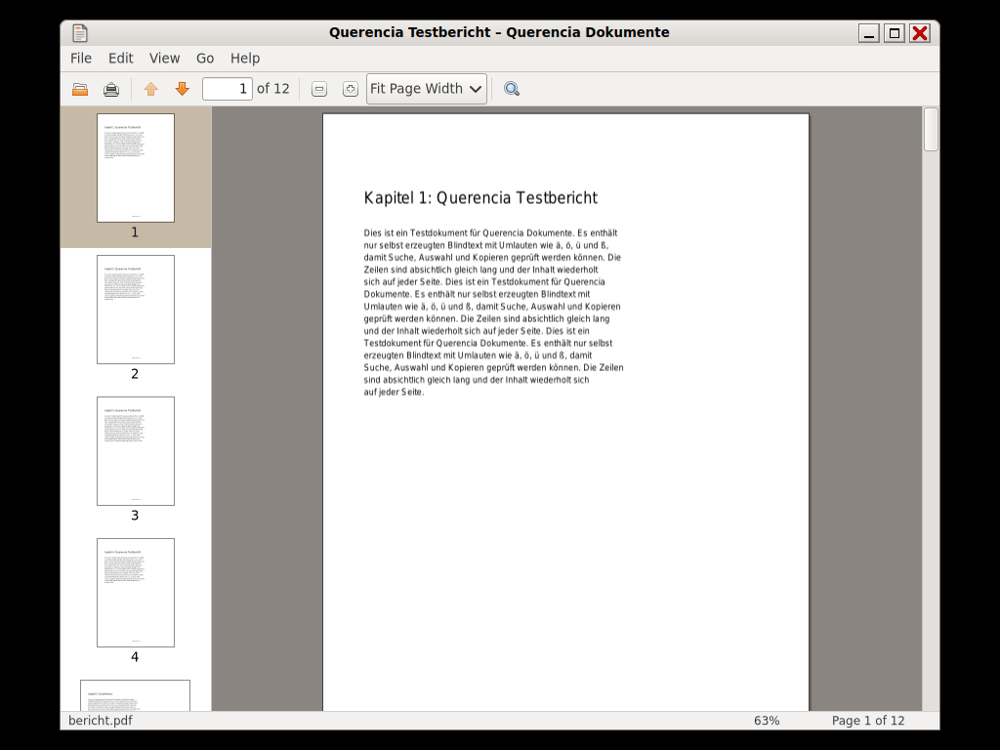

# Document Viewer (Querencia Dokumente)

[Back to contents](index.md)

**Start:** Applications → Office → Document Viewer, or double-click a PDF
file (Querencia Dokumente is the default for PDF).

A PDF viewer modelled on Evince 2.30. It **never writes** to documents.

## What the Document Viewer can do

- Open PDF via the dialog, from Files or by dropping it on the window; also
  password-protected PDF (asks for the password).
- Continuous scrolling, side pane with thumbnails, page field “page X of Y”
  (also page labels such as “iv”).
- Zoom in steps from 10 % to 400 %, “Best Fit”, “Fit Page Width”, Ctrl+mouse wheel.
- Text search with all hits highlighted, next and previous, optionally case
  sensitive.
- Select and copy text.
- Document properties (title, author, pages, paper size, dates).
- Printing via the GTK print dialog, fullscreen, recently opened documents.

## Keys

| Key | Effect |
|---|---|
| Ctrl+O, Ctrl+P, Alt+Return | Open, Print, Properties |
| Ctrl+W, Ctrl+Q | close window, quit |
| Ctrl+F, Ctrl+G or F3, Shift+Ctrl+G or Shift+F3, Esc | find, next, previous, close find bar |
| Ctrl+C, Ctrl+A | copy, select all |
| Ctrl+Plus or Ctrl+=, Ctrl+Minus, Ctrl+0, +/− | zoom, 100 % |
| PgDn/PgUp, Home/End, Ctrl+Home/Ctrl+End | next/previous, first/last page |
| Ctrl+L | page field |
| F9, F11 | side pane, fullscreen (Esc leaves) |

## Not included

Editing, saving, annotations, forms, signatures and other formats
(PostScript, DjVu, XPS, comics). Outline and links inside the document follow
in a later version. Printing on a real printer has not been tested yet.
