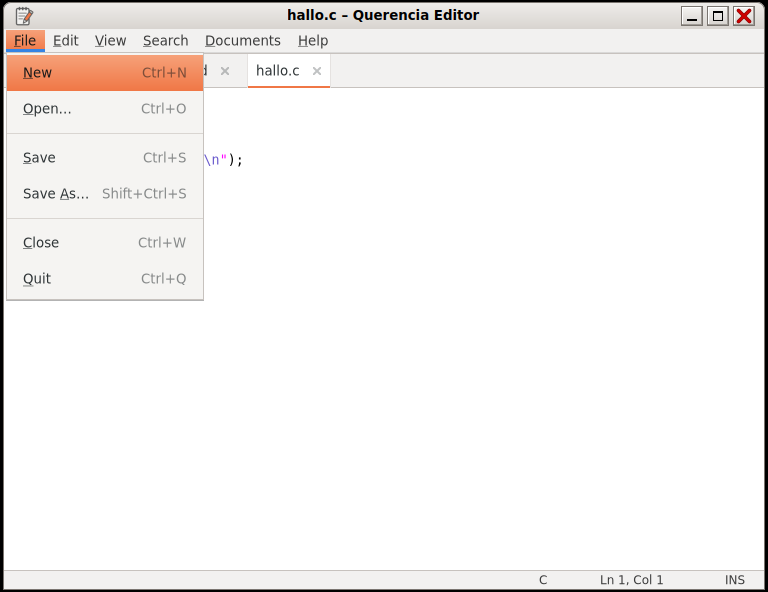

# Text Editor (Querencia Editor)

[Back to contents](index.md)

**Start:** Applications → Accessories → Text Editor, or double-click a text
file (the Text Editor is the default for plain text and Markdown).

A classic tabbed text editor modelled on gedit 2.30.

## What the editor can do

- Several documents in tabs of one window; another start opens a new tab. A
  “*” on the tab marks unsaved changes.
- Menu bar File · Edit · View · Search · Documents · Help with access keys and
  the gedit 2 shortcuts.
- UTF-8; character set and line endings of loaded files are kept.
- Line numbers, automatic indentation, bracket matching, optional line
  wrapping.
- Syntax highlighting for `.md .conf .ini .json .xml .sh .py .rs .c` and more;
  `.txt` as plain text.
- Find (Ctrl+F), Find Next (Ctrl+G), Find Previous (Shift+Ctrl+G), Replace
  (Ctrl+H) with match case, whole words and wrap around; Go to Line (Ctrl+I).
- Before a changed document is closed, the editor asks: Save, Cancel or Close
  without Saving.

More shortcuts: [Keyboard shortcuts](tastenkuerzel.md#programs).

## Not included

Printing, toolbar, side pane, plugins, spell checking, session restore,
preferences dialog.
