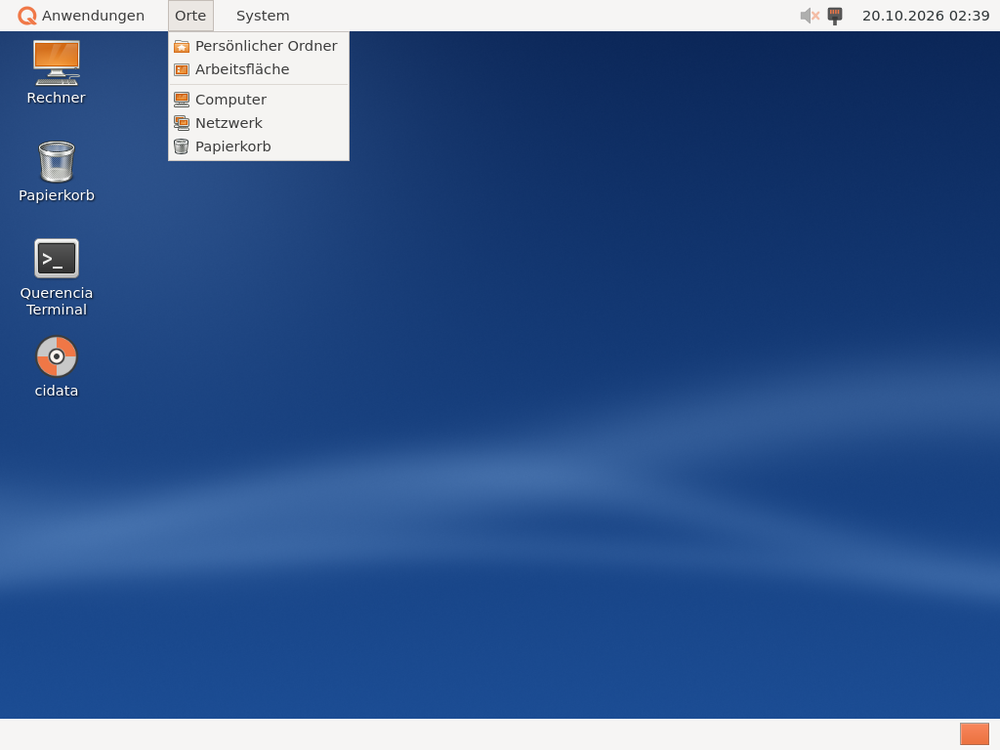

# Getting started

[Back to contents](index.md)

The panels and the desktop are German only for now; their labels are quoted
in German with an English translation.

## Logging in

Querencia Desktop is a session of its own. How to start it depends on the
system:

| System | How to log in |
|---|---|
| Ubuntu 26.04 Desktop (GDM login screen) | After installing, **restart once** (GDM reads new sessions only at start-up). On the login screen pick the user, click the gear at the bottom right, choose “Querencia Desktop”, enter the password. |
| Ubuntu 26.04 Server (no login screen) | Log in on the text console (tty1) and type `querencia-session`. |

Querencia also comes with a login screen of its own as an optional package
(`querencia-anmeldung`); it is not installed automatically, GDM remains the
recommendation. Details are in the
[Alpha 1 release notes](../../release-notes/en/alpha-1.md#own-login-screen-optional),
limits under [Known limitations](bekannte-einschraenkungen.md).

After logging in, the desktop with background and icons appears first, then
the two panels.

## The panels

Like GNOME 2, Querencia has two panels.

**Top:** on the left the Q logo with the menus **Anwendungen**
(Applications), **Orte** (Places) and **System**; on the right the **bell**
(notifications) and the **clock**. The bell counts unread notifications; a
click opens the notification centre (see
[Notifications](benachrichtigungen.md)). Clicking the clock opens a month
calendar. Volume and network icons can be added at the top right (see
below).

**Bottom:** on the left the **Arbeitsfläche anzeigen** (show desktop) button
and the **window list** (one button per window of the current workspace), on
the right the **workspace switcher** with four workspaces. “Arbeitsfläche
anzeigen” minimises all windows of the current workspace, a second click
brings exactly these back; **Super+D** does the same.

### Menu “Anwendungen” (Applications)

Programs are grouped as in the GNOME 2 menu of Ubuntu 10.04: Zubehör
(Accessories), Bildung (Education), Spiele (Games), Grafik (Graphics),
Internet, Büro (Office), Entwicklung (Programming), Unterhaltungsmedien
(Sound & Video), Systemwerkzeuge (System Tools), Barrierefreiheit (Universal
Access), Sonstige (Other). Empty groups are hidden; each program appears
exactly once. Newly installed programs appear without restarting the panel.

### Menu “Orte” (Places)

Home folder, Desktop, Documents, Music, Pictures, Videos and Downloads (only
those that exist), then Computer, Network and Trash. A click opens the place
in [Querencia Dateien](dateien.md).

### Menu “System”

- **Einstellungen** (Preferences) and **Systemverwaltung** (Administration)
  with the matching programs, among them [System Settings](einstellungen.md)
  and [Software](software.md).
- **Informationen über Querencia** (About Querencia) – version and licence.
- **Bildschirm sperren** (Lock Screen, Ctrl+Alt+L), **Abmelden …** (Log Out)
  and **Ausschalten …** (Shut Down) – logging out and shutting down ask
  first, see [Session](sitzung.md).

### Customising the panels

Right-click a free spot of a panel to open the panel menu:

- **Zum Panel hinzufügen …** (Add to Panel) opens a list with a search field:
  Anwendungen, Orte, System, Fensterliste (window list), Arbeitsfläche
  anzeigen (show desktop), Arbeitsflächenumschalter (workspace switcher), Uhr
  (clock), Mitteilungen (notifications), Anwendungsstarter … (launcher),
  Lautstärke (volume), Netzwerk (network). The
  new item goes into the area (left, centre, right) that was clicked.
- Right-click an item: **Aus dem Panel entfernen** (Remove from Panel), for
  launchers also **Starten** (Launch).
- **Moving:** drag an item with the middle mouse button, or choose
  “Verschieben” (Move) in its menu and finish with a click on the panel.

The layout is saved and restored at the next login. Moving an item from one
panel to the other is not possible yet.

## The desktop

The desktop shows the icons **Rechner** (Computer), **Persönlicher Ordner**
(Home) and **Papierkorb** (Trash), plus mounted drives (USB sticks, CDs,
network drives – which ones is set in [System Settings](einstellungen.md)
under “Symbole der Arbeitsfläche”, desktop icons).

- **Double-click** opens an icon; **F2** or “Umbenennen …” (Rename) changes
  its label.
- **Selecting:** click, Ctrl+click (add/remove), Shift+click (range), Ctrl+A
  (all), Esc (none), or drag a frame with the mouse.
- Icons can be moved freely; they snap to an invisible grid.
- **Right-click on free space:** create folder, empty file or document, sort
  by name, align icons to the grid, toggle the grid, **change desktop
  background …**
- **Right-click on the trash:** open, empty (with a safety question).
- **Right-click on a drive:** open, unmount or eject.

Included are 16 new backgrounds (default “Tiefblau”, deep blue; twelve
motifs and four variants with the Querencia logo) and the five motifs of
Alpha 1, four of them each with and without logo; choose them in System
Settings under “Background Image”.

## Workspaces

There are four workspaces. The switcher at the bottom right shows them as
small cells; a click or the mouse wheel changes the workspace.

| Shortcut | Effect |
|---|---|
| Ctrl+Alt+← / Ctrl+Alt+→ | workspace to the left / right |
| Ctrl+Alt+Shift+← / → | take the active window along |

Number and names of the workspaces are set in System Settings under
“Arbeitsflächen” (1 to 12).

## Windows

labwc draws the window frames in the “Querencia-Klassisch” theme, with the
program icon in the title bar.

| Shortcut | Effect |
|---|---|
| Alt+Tab / Alt+Shift+Tab | switch windows (with list) |
| Alt+F4 | close window |
| Super+A | maximise / restore |
| Super+F or Alt+F11 | fullscreen on / off |
| Super+←, →, ↑, ↓ | snap to the screen edge |
| Alt+Space | window menu |

In the window list a click activates a window; clicking the active window
minimises it, another click brings it back.

**Super+?** shows all shortcuts (program “Tastenkürzel”), see
[Keyboard shortcuts](tastenkuerzel.md).

## Log out, lock, shut down

- **Lock the screen:** System → Bildschirm sperren (Lock Screen) or
  Ctrl+Alt+L. After 10 minutes without input the screen locks itself.
- **Log out:** System → Abmelden … or Ctrl+Alt+Del.
- **Shut down or restart:** System → Ausschalten … or Ctrl+Alt+Del.

Details: [Session](sitzung.md).
