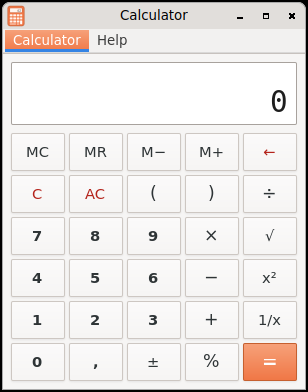

# Calculator (Querencia Rechner)

[Back to contents](index.md)

**Start:** Applications → Accessories → Calculator.

A calculator like gcalctool in basic mode (GNOME 2.30).

## What the calculator can do

- Digits and decimal comma, `+ − × ÷` with operator precedence and brackets,
  percent, square root, square, change sign, reciprocal.
- Memory M+, M−, MR, MC (the display shows “M” while something is stored);
  Backspace, C, AC.
- Calculates internally at full precision and rounds only for display:
  `2 √ x²` gives 2, `0,1 + 0,2 − 0,3` gives 0.
- Copy and paste with Ctrl+C and Ctrl+V.
- Errors (division by zero, overflow, square root of a negative number) are
  shown as text in the display.
- The decimal separator is the comma in both languages.

## Keys

Digits and comma · `+ - * / %` · Return or `=` result · Backspace last digit
· Del clear entry (C) · Esc clear all (AC) · S, Q, R, V square root, square,
reciprocal, sign · Ctrl+Q quit. The numeric keypad works as well.

## Not included

Scientific mode, programmer mode, units, history.
