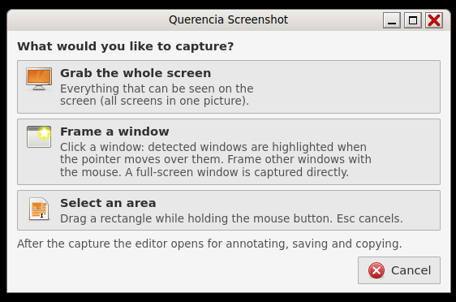

# Take Screenshot (Querencia Screenshot)

[Back to contents](index.md)

**Start:** the **Print** key, **Alt+Print** (one window) or Applications →
Accessories → Take Screenshot.

## Capturing

Print opens the window “What would you like to capture?”:

- **Grab the whole screen**
- **Frame a window** – detected windows light up when you move over them; a
  click captures the window including title bar and frame. Dragging outside a
  detected window frames freely. Esc cancels.
- **Select an area** – drag a rectangle.

Alt+Print goes straight to window selection. Esc, Ctrl+W or Ctrl+Q close the
selection window.

## Annotating

After each capture the editor opens, with a menu bar (File, Edit, Tools,
View) and a toolbar.

| Tool / action | Key |
|---|---|
| Ellipse (Shift = circle) | E |
| Rectangle (Shift = square) | R |
| Arrow | A |
| Pen | P |
| Text (click, type, Return; Esc discards) | T |
| Colour palette | F |
| Undo / Redo | Ctrl+Z / Ctrl+Shift+Z or Ctrl+Y |
| Save … / Copy to clipboard | Ctrl+S / Ctrl+C |
| New capture / Close | Ctrl+N / Ctrl+W or Ctrl+Q |

Eight basic colours (red is the default) and “Custom Color…”, three line
widths. “Remove All Annotations…” asks first and can be undone. The capture
itself stays unchanged; only saving and copying create a new PNG at original
size.

## Saving

The “Save Screenshot” dialog shows a preview, name and folder. The default is
the folder `Screenshots` inside the Pictures folder. Existing files are never
overwritten. Closing with unsaved annotations asks: “Close without Saving”,
“Cancel” or “Save …”.

`querencia-screenshot --open FILE` edits an existing PNG; it is saved under
a new name.

## Limits

Window selection only detects windows with a labwc frame; at a scale other
than 1 only free framing is available. In a virtual machine Alt+Print had no
effect during the installation test; this still needs checking on real
hardware.
