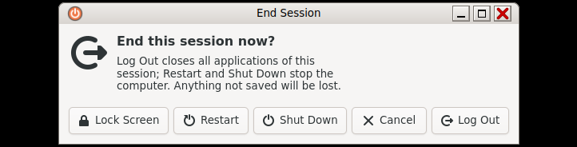

# Session: log out, lock, shut down (Querencia Sitzung)

[Back to contents](index.md)



## Locking the screen

- **Ctrl+Alt+L** or **System → Bildschirm sperren** (Lock Screen) locks at
  once.
- After **10 minutes** without input the screen locks itself.
- The lock screen shows a clock and a password field on every screen; unlock
  with your own password. The lock screen is German only.

## Session dialog

**Ctrl+Alt+Del** opens the dialog “End this session now?” with **Lock
Screen**, **Restart**, **Shut Down**, **Cancel** and **Log Out**. Esc closes
it; arrow keys and Return work.

## Log out and shut down from the menu

- **System → Abmelden …** (Log Out) asks “Log out of this system now?”.
- **System → Ausschalten …** (Shut Down) asks “Shut down this system now?”.

The questions wait until you choose; they do not count down by themselves.
If you want a countdown, add it to `~/.config/querencia/sitzung.ini`:

```ini
[Dialog]
Countdown=an
```

When logging out, Querencia first ends the programs of the session and then
the session services; you can log in again right away.

## Password dialog

When a program needs administrator rights (e.g. Software when installing,
restarting), the session's password dialog (“Authenticate”) asks for your own
password.

## Good to know

The session dialog stays light in the dark appearance too.
