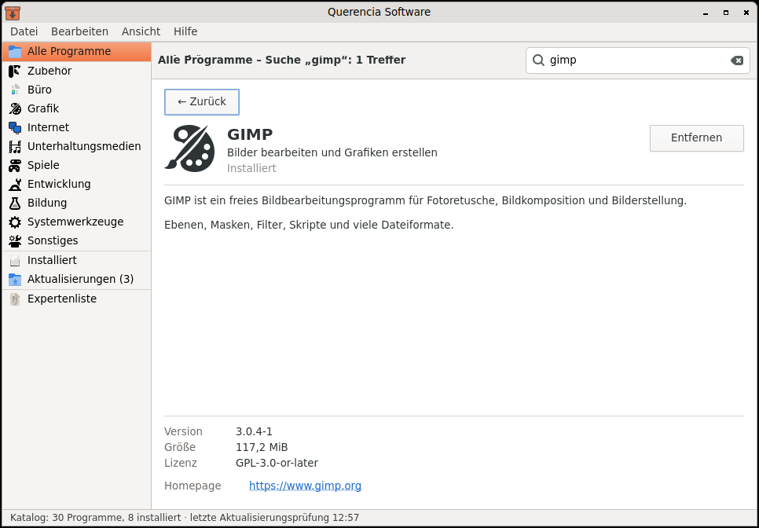

# Software (Querencia Software)

[Back to contents](index.md)

**Start:** System → Systemverwaltung (Administration) → Software.

Search, install, remove and update programs – via PackageKit, i.e. from the
system's package sources (Ubuntu archive).

## What Software can do

- **Search** as you type, **categories**, **Installed**, **Updates** and an
  **expert list** of all packages. Programs that Ubuntu lists in two package
  sources under slightly different IDs (such as Remmina) appear only once
  since Alpha 3.6.
- **Details page** with description, version, size, licence and homepage.
- **Install, remove, update:** before removing, Software shows which packages
  go along and asks. Progress runs inside the window with “Cancel”; you can go
  on browsing.
- For every change to the system the session's password dialog asks for your
  own password (users with administrator rights).
- Clear messages when the package system is busy, permission is missing or no
  password dialog is available.

## Not included

Managing package sources, ratings, accounts, Snap and Flatpak.

## When Software reports “no network connection”

On an Ubuntu Server system the network is often managed by systemd-networkd,
not by NetworkManager. PackageKit then considers the system offline and
downloads nothing. The fix from the installation guide: in
`/etc/netplan/*.yaml` add the line `renderer: NetworkManager` under
`network:` and run `sudo netplan apply`. Software detects this case itself
and shows a notice with this fix.
