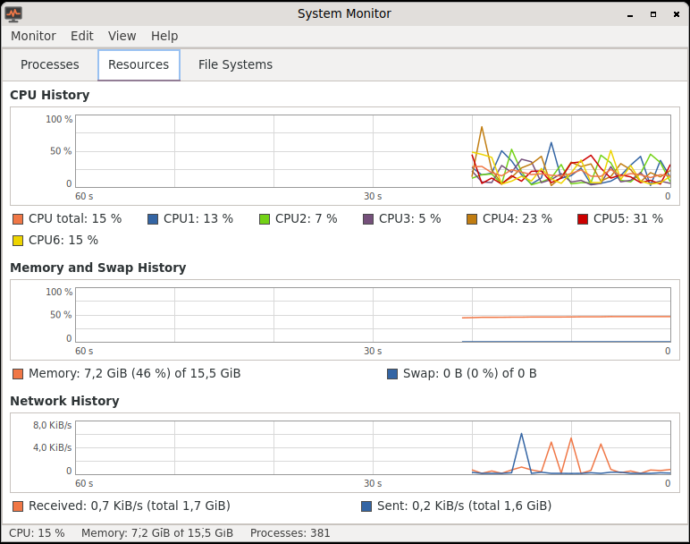

# System Monitor (Querencia Systemmonitor)

[Back to contents](index.md)

**Start:** Applications → System Tools → System Monitor.

Modelled on the GNOME 2 System Monitor, with three tabs.

## Processes

- Columns process name, user, PID, % CPU, memory, nice, status; click a
  column header to sort.
- Filter All / My / Active Processes, search by name, PID or user (Ctrl+F).
- Refreshes every 1 to 10 seconds (default 2 s); selection and scroll
  position stay put.
- **End Process** (Del or Ctrl+E) and **Kill Process** (Ctrl+K) with a
  question, **Change Priority** (Ctrl+N; without administrator rights only
  lower), **Properties** (Alt+Return or double-click): command line, working
  directory, start time, open files.
- Processes of other users are only shown.

## Resources

History of the last 60 seconds: CPU total and per core, memory and swap,
network received and sent.

## File Systems

Device, mount point, type, size, free, available, used with a bar. Virtual
file systems (tmpfs, overlay, squashfs) are hidden and can be shown.

The program remembers window size, tab, interval, filter, sorting and
columns.
